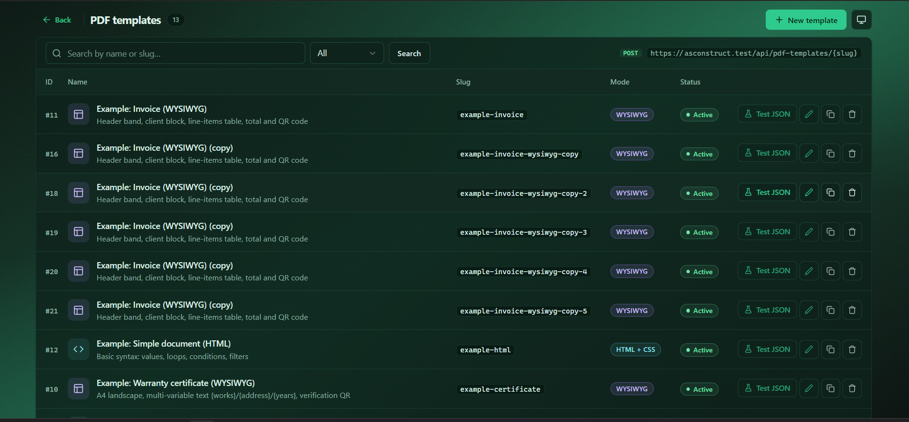
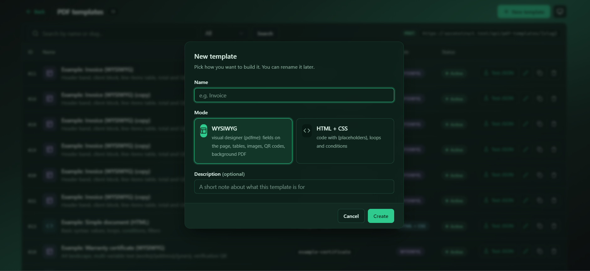
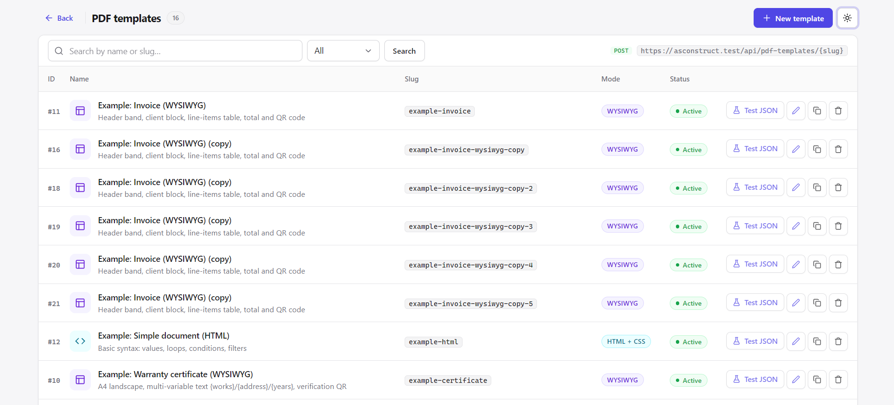
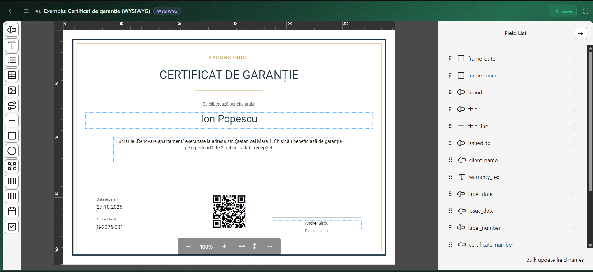
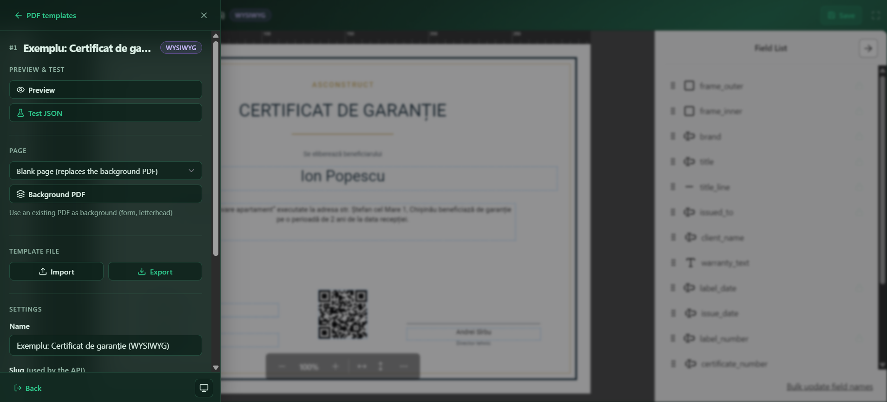
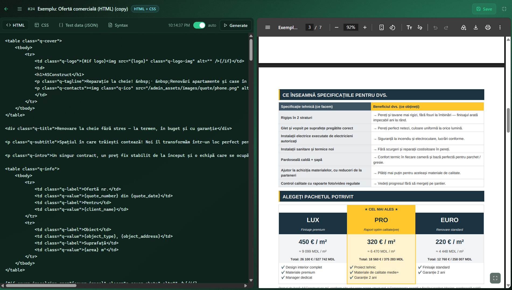
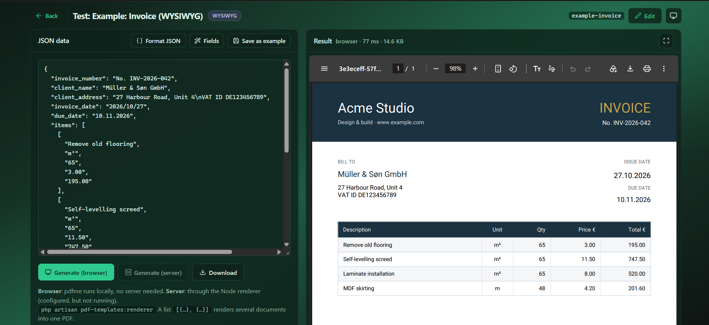
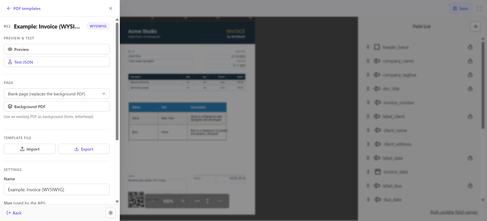

# Laravel PDF Templates

[](https://github.com/AnghelutaV/laravel-pdf-templates/actions/workflows/tests.yml)
[](https://packagist.org/packages/anghelutav/laravel-pdf-templates)
[](LICENSE)

PDF templates for Laravel, stored in the database, filled with JSON and rendered from your code or over HTTP. You can use it instead of a hosted service such as apitemplate.io.

There are two template modes:

- **WYSIWYG**: a visual designer ([pdfme](https://pdfme.com)) for fields on the page, tables, images, QR/barcodes and a background PDF.
- **HTML + CSS**: code with `{placeholders}`, loops, conditions and filters, rendered by dompdf.

It comes with a standalone admin UI (like log-viewer or Telescope) in light and dark themes. The UI has a template list, the designer, an HTML editor with live preview, and a JSON test page that shows the fields each template expects.

An **AI assistant** ([laravel/ai](https://github.com/laravel/ai): Anthropic, OpenAI, Gemini, Ollama…) writes and edits templates from a chat panel in both editors, or creates a new template from a description or a picture of an existing document.



<details>
<summary><strong>More screenshots</strong>: editors, test page, light theme</summary>

| | |
| --- | --- |
|  New template |  Light theme |
|  WYSIWYG designer (pdfme) |  Editor menu: preview, page, import / export, settings |
|  HTML + CSS editor with live preview |  Test page: JSON in, PDF out |
|  Editor menu, light theme | |

</details>

## Requirements

- PHP 8.3+ and Laravel 12 or 13. For Laravel 11 / PHP 8.2 use version 0.2.x (no AI assistant).
- Node.js 18+, only to render **WYSIWYG** templates on the server (in code or through the API). The browser designer and the HTML mode don't need Node.

## Installation

```bash
composer require anghelutav/laravel-pdf-templates
php artisan pdf-templates:install --examples
```

This publishes `config/pdf-templates.php`, creates the `pdf_templates` table and adds three example templates.

Open **`/pdf-templates`**. In the `local` environment it's open to everyone. Everywhere else, define who may use it, for example in `AppServiceProvider::boot()`:

```php
Gate::define('viewPdfTemplates', fn ($user = null) => $user?->is_admin);
```

## Usage in code

```php
use AnghelutaV\PdfTemplates\Facades\PdfTemplates;

// From a controller: shown inline in the browser
return PdfTemplates::make('invoice', $data);

// Download, store, base64, mail attachment
return PdfTemplates::make('invoice', $data)->filename("invoice-{$order->id}")->download();
PdfTemplates::make('invoice', $data)->save("invoices/{$order->id}.pdf", 's3');
$base64 = PdfTemplates::make('invoice', $data)->base64();

// Raw bytes
$bytes = PdfTemplates::render('invoice', $data);
```

`$data` is an array or a raw JSON string. A list of objects (`[{…}, {…}]`) renders several documents into one PDF. `make()` renders once, so you can call `save()` and then `download()` on the same object.

### Mail attachments

```php
public function attachments(): array
{
    return [PdfTemplates::make('invoice', $this->order->toPdfData())->filename('invoice')->attachment()];
}
```

### Let users pick a template

```blade
<x-pdf-templates::select name="pdf_template" :value="old('pdf_template', $order->pdf_template)" placeholder="—" class="form-select" />
```

```php
PdfTemplates::options();        // ['invoice' => 'Invoice', ...]  active templates
PdfTemplates::options('html');  // only one mode
```

### What data does a template expect?

```php
PdfTemplates::fields('invoice');
// HTML:    ['title' => 'value', 'items' => 'list', 'items.*.name' => 'value', 'paid' => 'condition']
// WYSIWYG: ['client_name' => 'text', 'items' => 'table', 'payment_link' => 'qrcode']
```

The same list is shown on each template's test page, and by `php artisan pdf-templates:render invoice --fields`.

## HTTP API

Set a key in `.env`. You can generate one with `php -r "echo bin2hex(random_bytes(32));"`.

```bash
PDF_TEMPLATES_API_KEY=your-long-random-key
```

```bash
curl -X POST https://your-app.test/api/pdf-templates/invoice \
  -H "X-API-KEY: $PDF_TEMPLATES_API_KEY" \
  -H "Content-Type: application/json" \
  --data @data.json -o invoice.pdf
```

- **Request body:** the JSON data.
- **Response:** `application/pdf`. Optional query parameters: `?download=1` and `?filename=name`.
- **Errors** come back as JSON:

| Status | Meaning                         |
| ------ | ------------------------------- |
| `401`  | wrong or missing key            |
| `403`  | API disabled (no key set)       |
| `404`  | unknown or inactive template    |
| `422`  | invalid JSON or template syntax |

The API is stateless: no session and no CSRF.

## Template syntax (HTML mode)

| Syntax                                                                   | Meaning                                                                                       |
| ------------------------------------------------------------------------ | --------------------------------------------------------------------------------------------- |
| `{name}` `{client.address}` `{items.0.name}`                             | escaped value, dot paths                                                                      |
| `{#each items} … {else} empty {/each}`                                   | loop; inside: `{name}`, `{this}`, `{@number}`, `{@index}`, `{@first}`, `{@last}`, `{@root.x}` |
| `{#if paid} … {else} … {/if}`, `{#unless paid} … {/unless}`              | conditions; these count as false: `null`, `""`, `0`, `"false"`, `[]`                          |
| `{total\|number:2}` `{date\|date:d.m.Y}` `{name\|upper}` `{name\|lower}` | filters, which can be chained                                                                 |
| `{phone\|default:—}` `{notes\|nl2br}` `{html\|raw}`                      | fallback value, line breaks, unescaped HTML                                                   |

Templates can't run PHP. dompdf runs with remote resources disabled, so images must be `data:` URIs or files under `public/`; same-host URLs are mapped to local files. Fonts: `DejaVu Sans` by default, and more TTF fonts can be added in `html.fonts`.

## WYSIWYG data

Each designer field has a **name**, which is its key in the JSON. Values are strings, except:

- table: `[["a","b"],["c","d"]]`
- list: `["x","y"]`
- multi-variable text: `{"var":"value"}`
- image: `data:image/png;base64,…`

The **Page…** menu in the designer resizes the page and scales every field to the new size.

### Rendering WYSIWYG on the server

pdfme only runs in JavaScript, so server-side generation goes through the bundled Node renderer:

```bash
php artisan pdf-templates:renderer      # installs npm deps on first run, listens on 127.0.0.1:3311
```

```bash
PDFME_RENDERER_URL=http://127.0.0.1:3311
PDFME_RENDERER_TOKEN=optional-shared-secret
```

In production, run it under supervisor or systemd. You can also copy `vendor/anghelutav/laravel-pdf-templates/renderer` anywhere and run `npm install && npm start` (env: `HOST`, `PORT`, `PDFME_RENDERER_TOKEN`).

## AI assistant

The editors have an **AI** button (Ctrl+I) that opens a chat panel on the right. Ask for a change ("add a footer with page numbers", "a QR code in the bottom right corner") or attach an image / PDF of a document to copy. The answer goes into the editor as **unsaved** changes: the preview refreshes, every answer can be undone, and nothing is stored until you press Save. In the list, the "New template" dialog can also **Generate with AI** from a description.

It runs on [laravel/ai](https://laravel.com/docs/ai-sdk) (installed with the package) and is shown once the provider has a key:

```dotenv
ANTHROPIC_API_KEY=sk-ant-...
# optional
PDF_TEMPLATES_AI_PROVIDER=anthropic       # any laravel/ai text provider: openai, gemini, mistral, ollama, ...
PDF_TEMPLATES_AI_MODEL=claude-sonnet-5-5  # empty = the provider's default model
PDF_TEMPLATES_AI_FORMAT=structured        # "text" for small / free models (see below)
PDF_TEMPLATES_AI=false                    # hide the assistant
```

Keys for the other providers (`OPENAI_API_KEY`, `GEMINI_API_KEY`, `GROQ_API_KEY`, …) are read by `config/ai.php` (`php artisan vendor:publish --provider="Laravel\Ai\AiServiceProvider"`).

Two answer formats:

- `structured` (default) for strong models (Claude, GPT, Gemini): structured JSON output, and the model calls check tools (template syntax and data keys, pdfme fields) before it answers.
- `text` for small or free models (Groq, Ollama…) that fail with `Failed to generate JSON` or `tool_use_failed`: the model writes plain `<pt:html>…</pt:html>` sections, no tools.

In both, the answer is also checked on the server (template syntax; JSON, field types, names and page bounds in WYSIWYG mode) and, when it has problems, sent back to the model once (`ai.retries`) to fix. Embedded files (background PDF, data-URL images) are replaced by placeholders before the request and put back in the answer, so large templates stay cheap.

**Privacy:** the current template (with its test data), the chat history of the browser tab and the attached file are sent to the AI provider. Use sample data, not real customer data.

## Templates in git: export and import

Templates live in the database. To keep them in version control and ship them with deploys:

```bash
php artisan pdf-templates:export                  # database/pdf-templates/<slug>/…
php artisan pdf-templates:import                  # on deploy, keeps templates that already exist
php artisan pdf-templates:import --force          # overwrite
```

## Commands

| Command                                                               | Does                                        |
| --------------------------------------------------------------------- | ------------------------------------------- |
| `pdf-templates:install [--examples]`                                  | publish config, migrate, add examples       |
| `pdf-templates:examples [--force]`                                    | add the example templates                   |
| `pdf-templates:render {slug} {output?} [--data=file.json] [--fields]` | render from the console, or list the fields |
| `pdf-templates:benchmark {slug?*} [--runs] [--docs] [--data] [--cache]` | time / memory / size per template         |
| `pdf-templates:export {path?} [--slug=*]`                             | templates → files                           |
| `pdf-templates:import {path?} [--force]`                              | files → templates                           |
| `pdf-templates:renderer [--host] [--port] [--install]`                | run the Node renderer                       |

## Configuration

`config/pdf-templates.php`:

| Key                                         | Default                                                |                                                                                               |
| ------------------------------------------- | ------------------------------------------------------ | --------------------------------------------------------------------------------------------- |
| `routes.prefix` / `routes.middleware`       | `pdf-templates` / `['web']`                            | admin UI URL and middleware                                                                   |
| `gate`                                      | `viewPdfTemplates`                                     | `null` = no gate check                                                                        |
| `layout` / `section`                        | `null` / `content`                                     | render inside your own admin layout (it must have `@stack('styles')` and `@stack('scripts')`) |
| `back_url`                                  | `null`                                                 | back link in the UI header: path (`admin`, `/admin`) or full URL                              |
| `back_label`                                | `null`                                                 | back label link UI header                                                                     |
| `ui.repository`                             | GitHub repo URL                                        | GitHub (with star count) and docs links in the list header; `null` hides them                 |
| `api.prefix` / `api.middleware` / `api.key` | `api/pdf-templates` / `['api', 'throttle:60,1']` / env | HTTP API                                                                                      |
| `routes.render_throttle`                    | `120,1`                                                | admin preview / test renders per user per minute                                              |
| `cache.ttl` / `cache.store`                 | `0` (off) / default store                              | reuse generated PDFs for identical template + data (see Production)                           |
| `ai.enabled` / `ai.provider` / `ai.model`   | env / `anthropic` / `claude-sonnet-5-5`                | AI assistant (see AI assistant)                                                               |
| `ai.format`                                 | `structured`                                           | `text` for small / free models                                                                |
| `ai.throttle` / `ai.history` / `ai.retries` | `20,1` / `20` / `1`                                    | AI requests per user per minute, previous chat messages sent, re-asks for an invalid answer    |
| `ai.max_upload_kb` / `ai.timeout`           | `10240` / `120`                                        | attached image / PDF size, seconds per AI request                                             |
| `table`                                     | `pdf_templates`                                        | database table                                                                                |
| `pdfme.*`                                   |                                                        | pdfme version, CDN, renderer URL and token                                                    |
| `html.*`                                    |                                                        | default font, extra fonts, number separators, extra dompdf `chroot` dirs                      |

To publish the views or translations (`en`, `ro`): `php artisan vendor:publish --tag=pdf-templates-views` or `--tag=pdf-templates-lang`.

## Production

**Keep the Node renderer running** (only needed for WYSIWYG on the server: API, `PdfTemplates::render()`, "Generate (server)"). It answers `GET /health`; the test page uses it to show whether it is up. Supervisor:

```ini
[program:pdf-templates-renderer]
command=php /var/www/app/artisan pdf-templates:renderer --host=127.0.0.1 --port=3311
autostart=true
autorestart=true
user=www-data
stdout_logfile=/var/www/app/storage/logs/pdf-renderer.log
redirect_stderr=true
```

Or pm2 from the renderer folder: `pm2 start server.mjs --name pdf-renderer && pm2 save`. Keep it on `127.0.0.1` (or set `PDFME_RENDERER_TOKEN` when it listens on a network).

**Cache repeated PDFs.** The same template content with the same data gives the same PDF; with a cache the second request skips the generation (dompdf / renderer):

```bash
PDF_TEMPLATES_CACHE_TTL=3600     # seconds, 0 = off
PDF_TEMPLATES_CACHE_STORE=redis  # or file; not "database" (binary PDF bytes)
```

Editing a template changes its content, so old entries are never served for it. Changing fonts or number separators in the config is not part of the key: clear the cache after that.

**Many PDFs at once** (mass mailing, exports): generate them in queued jobs, not in the request, e.g. `PdfTemplates::make('invoice', $data)->save("invoices/{$id}.pdf")` inside a job.

**Limits.** The API is throttled by `api.middleware` (`throttle:60,1`), admin renders by `routes.render_throttle`. Each render is a full PDF generation, so keep them sized to your server.

**`{value|raw}` prints unescaped HTML from the data.** Use it only for HTML you produce yourself, never for text typed by end users (it could inject markup or CSS into the document; dompdf runs no JavaScript and has remote resources disabled).

**pdfme comes from a CDN** (`pdfme.cdn`, esm.sh) when the WYSIWYG editor opens. Offline or locked-down environments can point `pdfme.cdn` to a mirror that serves the same module paths.

## Testing

```bash
composer test
```

## License

MIT
