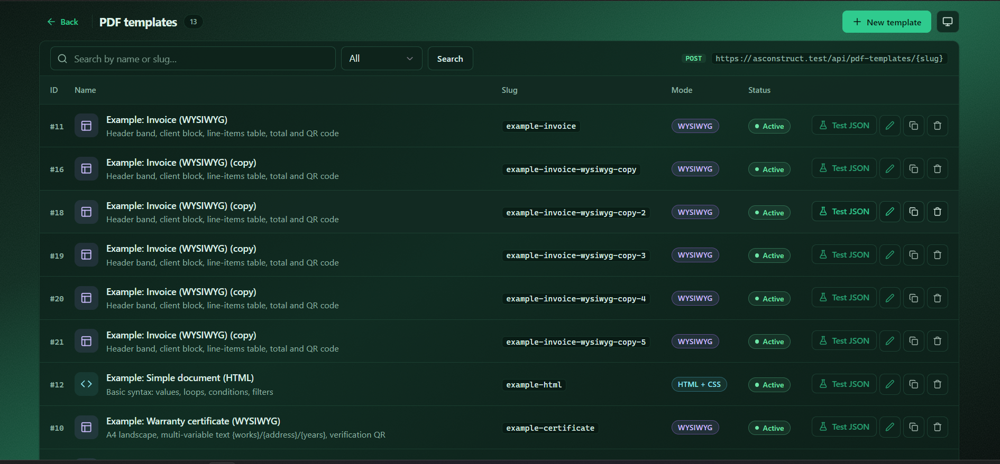
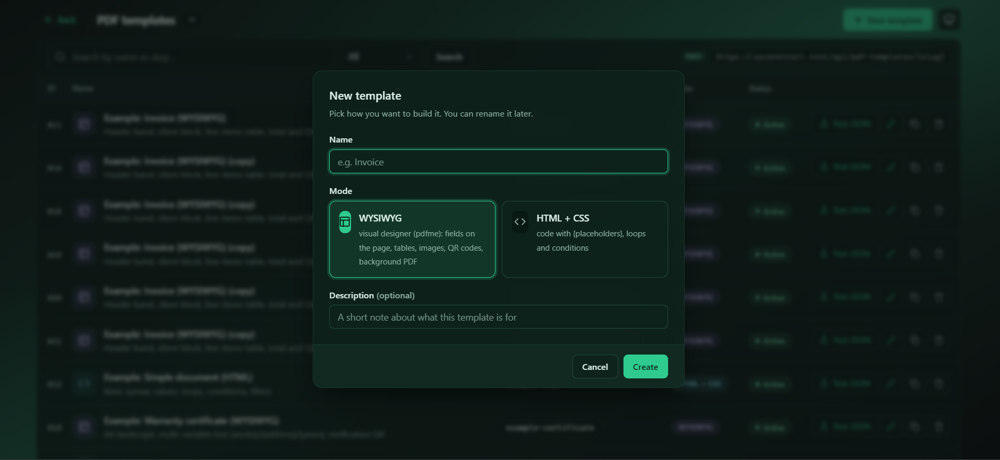
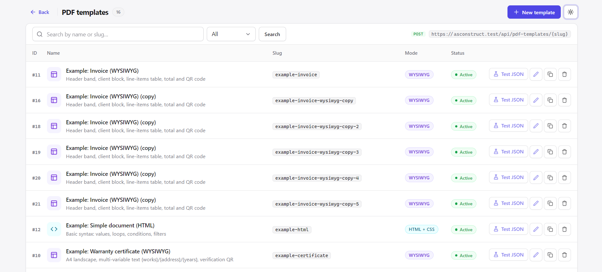
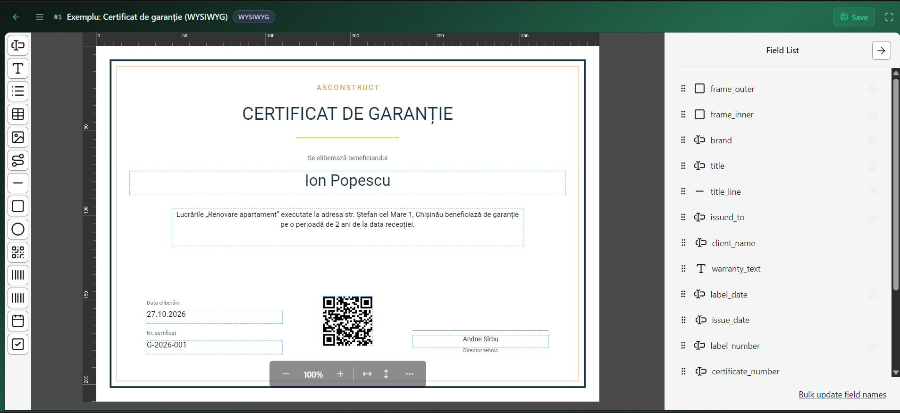
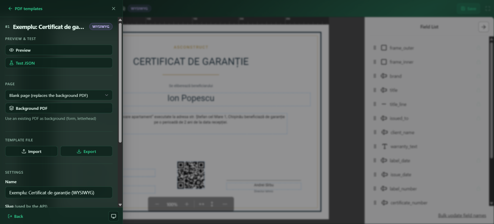
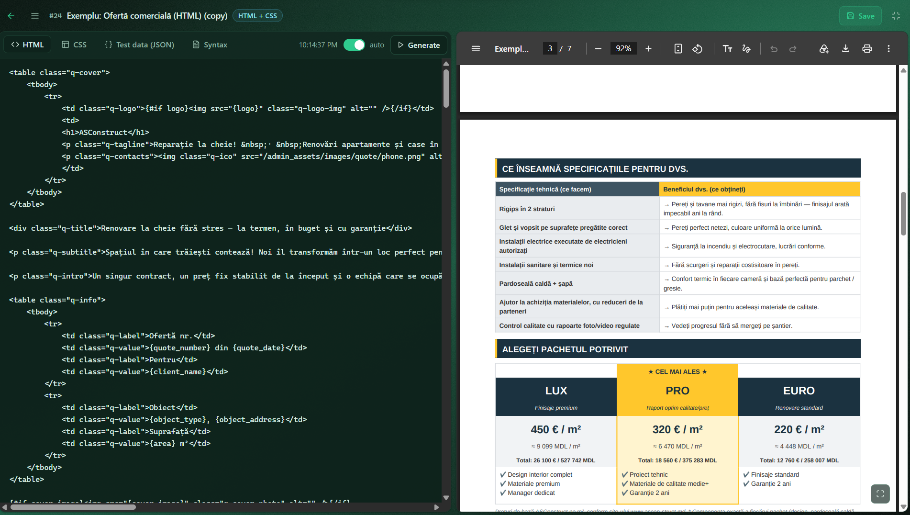
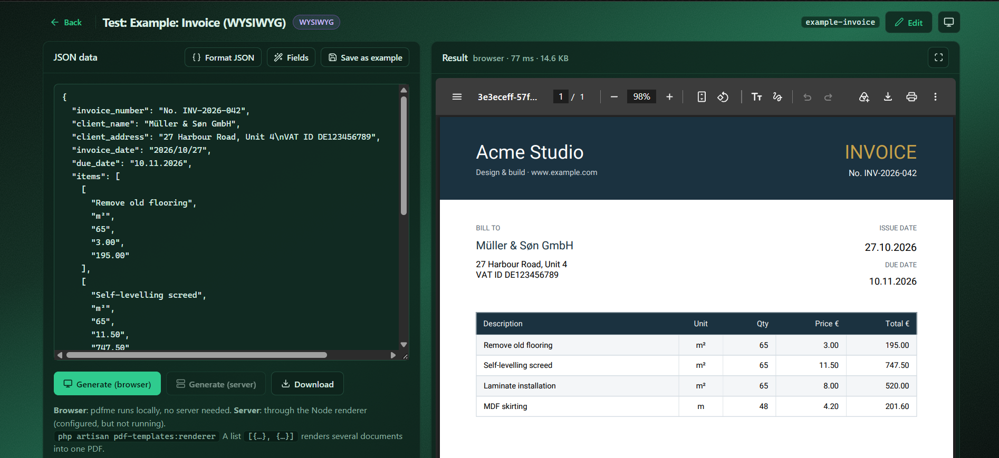
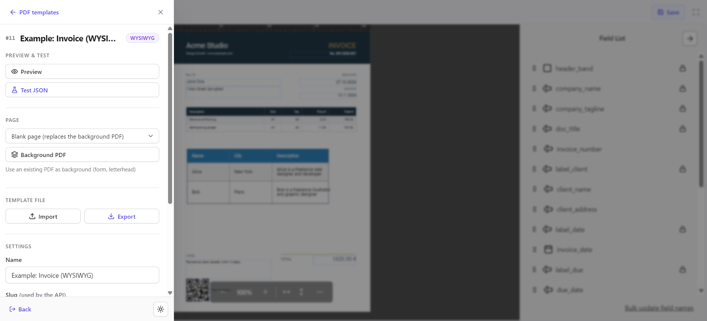

# Laravel PDF Templates

[](https://github.com/AnghelutaV/laravel-pdf-templates/actions/workflows/tests.yml)
[](https://packagist.org/packages/anghelutav/laravel-pdf-templates)
[](LICENSE)

PDF templates for Laravel, stored in the database, filled with JSON and rendered from your code or over HTTP. You can use it instead of a hosted service such as apitemplate.io.

There are two template modes:

- **WYSIWYG**: a visual designer ([pdfme](https://pdfme.com)) for fields on the page, tables, images, QR/barcodes and a background PDF.
- **HTML + CSS**: code with `{placeholders}`, loops, conditions and filters, rendered by dompdf.

It comes with a standalone admin UI (like log-viewer or Telescope) in light and dark themes. The UI has a template list, the designer, an HTML editor with live preview, and a JSON test page that shows the fields each template expects.

An **AI assistant** ([laravel/ai](https://github.com/laravel/ai): Anthropic, OpenAI, Gemini, Ollama…) writes and edits templates from a chat panel in both editors, or creates a new template from a description or a picture of an existing document.



<details>
<summary><strong>More screenshots</strong>: editors, test page, light theme</summary>

| | |
| --- | --- |
|  New template |  Light theme |
|  WYSIWYG designer (pdfme) |  Editor menu: preview, page, import / export, settings |
|  HTML + CSS editor with live preview |  Test page: JSON in, PDF out |
|  Editor menu, light theme | |

</details>

## Requirements

- PHP 8.3+ and Laravel 12 or 13. For Laravel 11 / PHP 8.2 use version 0.2.x (no AI assistant).
- Node.js 18+, only to render **WYSIWYG** templates on the server (in code or through the API). The browser designer and the HTML mode don't need Node.

## Installation

```bash
composer require anghelutav/laravel-pdf-templates
php artisan pdf-templates:install --examples
```

This publishes `config/pdf-templates.php`, creates the `pdf_templates` table and adds four example templates (one of them a multi-page report with a header, footer and page numbers).

Open **`/pdf-templates`**. In the `local` environment it's open to everyone. Everywhere else, define who may use it in `AppServiceProvider::boot()`, either with a callback (like `LogViewer::auth()`):

```php
use AnghelutaV\PdfTemplates\Facades\PdfTemplates;

PdfTemplates::auth(fn ($request) => auth('web')->check());
```

or with a gate:

```php
Gate::define('viewPdfTemplates', fn ($user = null) => $user?->is_admin);
```

When both are set, `PdfTemplates::auth()` decides.

## Usage in code

```php
use AnghelutaV\PdfTemplates\Facades\PdfTemplates;

// From a controller: shown inline in the browser
return PdfTemplates::make('invoice', $data);

// Download, store, base64, mail attachment
return PdfTemplates::make('invoice', $data)->filename("invoice-{$order->id}")->download();
PdfTemplates::make('invoice', $data)->save("invoices/{$order->id}.pdf", 's3');
$base64 = PdfTemplates::make('invoice', $data)->base64();

// Raw bytes
$bytes = PdfTemplates::render('invoice', $data);

// A diagonal watermark on every page (both modes)
PdfTemplates::make('invoice', $data)->watermark('DRAFT')->download();
PdfTemplates::render('invoice', $data, ['watermark' => ['text' => 'COPY', 'color' => '#dc2626', 'opacity' => 0.1, 'angle' => 45]]);

// Several PDFs in one ZIP; the file name can use the item's data
$zip = PdfTemplates::zip([
    ['template' => 'invoice', 'data' => $first, 'filename' => 'invoice-{{ number }}'],
    ['template' => 'receipt', 'data' => $second],
]);
```

`$data` is an array or a raw JSON string. A list of objects (`[{…}, {…}]`) renders several documents into one PDF. `make()` renders once, so you can call `save()` and then `download()` on the same object.

### Mail attachments

```php
public function attachments(): array
{
    return [PdfTemplates::make('invoice', $this->order->toPdfData())->filename('invoice')->attachment()];
}
```

### Generating in a queue (many PDFs)

`->queue()` renders in a queue worker instead of the request and stores the file; the request only saves and answers. Events tell your app how it went, so the status can live on your own model:

```php
use AnghelutaV\PdfTemplates\Facades\PdfTemplates;

PdfTemplates::make('invoice', $invoice->toPdfData())
    ->watermark($invoice->isDraft() ? 'DRAFT' : null)
    ->queue("invoices/{$invoice->id}.pdf", 'local', ['invoice' => $invoice->id]);   // returns the dispatch: ->delay(), ->onQueue()…
```

The job (`AnghelutaV\PdfTemplates\Jobs\GeneratePdf`) runs on the queue `pdf` (config `queue.name`, `queue.connection`), with 3 tries (10 s, 30 s, 90 s apart) and a 120 s timeout (`queue.tries`, `queue.timeout`). The same file is never rendered twice at once (a double click waits for the first job), and while the Node renderer is down or busy the job backs off instead of using up its tries. It fires:

| Event | Properties |
|---|---|
| `Events\PdfGenerating` | `path`, `disk`, `context`, `attempt` |
| `Events\PdfGenerated` | `path`, `disk`, `bytes`, `durationMs`, `context` |
| `Events\PdfGenerationFailed` | `path`, `disk`, `error`, `context` (all tries used) |

<details>
<summary>Complete example: invoice with a PDF status, a controller and polling</summary>

```php
// migration
Schema::table('invoices', function (Blueprint $table) {
    $table->string('pdf_status', 16)->default('pending')->index();   // pending | processing | completed | failed
    $table->string('pdf_path')->nullable();
    $table->text('pdf_error')->nullable();
    $table->timestamp('pdf_generated_at')->nullable();
});

// app/Listeners/InvoicePdfStatus.php (auto-discovered, or Event::listen in a provider)
use AnghelutaV\PdfTemplates\Events\{PdfGenerating, PdfGenerated, PdfGenerationFailed};

class InvoicePdfStatus
{
    public function handle(PdfGenerating|PdfGenerated|PdfGenerationFailed $event): void
    {
        if (! isset($event->context['invoice'])) {
            return;   // another document
        }
        Invoice::whereKey($event->context['invoice'])->update(match (true) {
            $event instanceof PdfGenerating => ['pdf_status' => 'processing'],
            $event instanceof PdfGenerated => ['pdf_status' => 'completed', 'pdf_path' => $event->path, 'pdf_error' => null, 'pdf_generated_at' => now()],
            default => ['pdf_status' => 'failed', 'pdf_error' => $event->error],
        });
    }
}

// controller
public function store(StoreInvoiceRequest $request)
{
    $invoice = Invoice::create($request->validated() + ['pdf_status' => 'pending']);
    PdfTemplates::make('invoice', $invoice->toPdfData())->queue("invoices/{$invoice->id}.pdf", 'local', ['invoice' => $invoice->id]);

    return response()->json(['id' => $invoice->id, 'status' => 'pending', 'status_url' => route('invoices.pdf.status', $invoice)], 202);
}

public function pdfStatus(Invoice $invoice)
{
    $this->authorize('view', $invoice);

    return [
        'status' => $invoice->pdf_status,
        'error' => $invoice->pdf_error,
        'download_url' => $invoice->pdf_status === 'completed' ? route('invoices.pdf', $invoice) : null,
    ];
}

public function pdf(Invoice $invoice)
{
    $this->authorize('view', $invoice);
    abort_unless($invoice->pdf_status === 'completed', 404);

    return Storage::disk('local')->download($invoice->pdf_path, "invoice-{$invoice->number}.pdf");
}
```

Livewire polls on its own until it is done:

```blade
@if (in_array($invoice->pdf_status, ['pending', 'processing']))
    <span wire:poll.3s="$refresh">Generating PDF…</span>
@elseif ($invoice->pdf_status === 'completed')
    <a href="{{ route('invoices.pdf', $invoice) }}">Download PDF</a>
@else
    <span>PDF failed: {{ $invoice->pdf_error }}</span>
@endif
```

Without Livewire: `fetch(status_url)` every 2–3 s until `status` is `completed` / `failed`. A WebSocket (Reverb) is not needed for this; if you already run one, broadcast from the listener.

For big data, pass only the id: your own job loads the invoice and calls `PdfTemplates::make(...)->save($path)`; give it the same `$tries`, `$timeout` and `WithoutOverlapping("invoice-pdf:{$id}")`.
</details>

**Workers.** A queue of its own means the number of workers on it is the number of PDFs made at once (each is CPU and memory; with the Chrome engine, a Chrome page). Restart them regularly so memory cannot grow:

```bash
php artisan queue:work redis --queue=pdf --tries=3 --timeout=120 --max-jobs=500 --max-time=3600 --memory=256
```

Run 2 of them (Supervisor `numprocs=2`, or 2 containers) next to the worker of your other queues; the connection's `retry_after` must be longer than `--timeout` (e.g. 180). After a deploy: `php artisan queue:restart`. Two workers at about a second per PDF make thousands of PDFs an hour.

### Let users pick a template

```blade
<x-pdf-templates::select name="pdf_template" :value="old('pdf_template', $order->pdf_template)" placeholder="—" class="form-select" />
```

```php
PdfTemplates::options();        // ['invoice' => 'Invoice', ...]  active templates
PdfTemplates::options('html');  // only one mode
```

### What data does a template expect?

```php
PdfTemplates::fields('invoice');
// HTML:    ['title' => 'value', 'items' => 'list', 'items.*.name' => 'value', 'paid' => 'condition']
// WYSIWYG: ['client_name' => 'text', 'items' => 'table', 'payment_link' => 'qrcode']
```

The same list is shown on each template's test page, and by `php artisan pdf-templates:render invoice --fields`.

## HTTP API

**Keys.** Create one per client (an app, a customer) in the admin UI → **API**, or with `php artisan pdf-templates:api-key "Shop"`. The key is shown once; only its hash is stored, and it can be revoked at any time. A master key in `.env` works too and sees every render:

```bash
PDF_TEMPLATES_API_KEY=your-long-random-key
```

```bash
curl -X POST https://your-app.test/api/pdf-templates/invoice \
  -H "X-API-KEY: pt_your_key" \
  -H "Content-Type: application/json" \
  --data @data.json -o invoice.pdf
```

The key goes in `X-API-KEY` or `Authorization: Bearer …`. **Body:** the JSON data; a JSON array makes several documents in one file.

| Request                                      | Answer                                                                                     |
| -------------------------------------------- | ------------------------------------------------------------------------------------------ |
| `POST /api/pdf-templates/{slug}`             | the PDF (`?download=1`, `?filename=name`); header `X-Render-Id`                            |
| `… ?output=base64`                           | JSON `{ id, filename, mime, bytes, data }`                                                 |
| `… ?output=url`                              | JSON `{ id, status, url, expires_at }`; the link is signed, needs no key, expires          |
| `… ?format=png&page=1` / `?format=jpg`       | one page as an image (needs the Node renderer; jpg needs PHP GD)                           |
| `… ?async=1&webhook=https://…`               | `202 { id, status: "queued", status_url }` at once; rendered by a queue worker, then POSTed to the webhook |
| `… ?watermark=DRAFT`                         | a diagonal text on every page; `&watermark_color=%23dc2626&watermark_opacity=0.2`          |
| `POST /api/pdf-templates/batch`              | a ZIP with one PDF per item, see below; takes `output`, `async`, `webhook`, `watermark`     |
| `GET /api/pdf-templates/templates`           | active templates with the data keys each one uses                                          |
| `GET /api/pdf-templates/templates/{slug}`    | one template, with its test data as `example` (a ready body)                               |
| `GET /api/pdf-templates/renders/{id}`        | `queued` → `processing` → `done` (with `url`) or `failed` (with `error`)                   |

- **Batch:** `{"template": "invoice", "items": [{…}, {…}], "filename": "invoice-{{ number }}"}`, or a template per item: `{"items": [{"template": "invoice", "data": {…}, "filename": "a"}, {"template": "receipt", "data": {…}}]}`. At most `api.batch_max` (100) items; equal file names get `-2`, `-3`. A template called `batch` cannot be rendered through the API.
- **Limits per key** (admin **API** page → keys): requests per minute and documents per calendar month (failed renders do not count), with the usage of this month and of the last 30 days. Over a limit the answer is `429` (`Retry-After` for the per-minute one; `limit`, `used`, `resets_at` for the monthly one). The master key has no limits.
- **Webhooks** get the same JSON as `renders/{id}`. With `PDF_TEMPLATES_WEBHOOK_SECRET`, the `X-Signature` header is the HMAC-SHA256 of the body. Private / local addresses are refused (`api.webhook_private`).
- **Async** needs a queue worker (`php artisan queue:work`); `api.queue_connection` / `api.queue` pick where the jobs go.
- **Files** of `output=url` and async renders are kept on `api.disk` for `api.files_ttl` minutes (1440).
- **Log:** every API render is logged (template, key, status, time, size, error, IP, client, query options and the JSON sent) on the admin **API** page, with 24-hour stats. A click on a row shows its details and **Render again**. The data can hold customer data: `PDF_TEMPLATES_LOG_DATA=false` keeps only the rest; bodies over `api.log_data_kb` (512) are not kept. Schedule `pdf-templates:prune` daily to delete expired files and log rows older than `api.log_days` (30).
- **Admin API page:** tabs **Server & keys** (start / restart / stop the Node renderer on this machine, its status and output; create / revoke keys), **Documentation** (every endpoint, parameter, response and error, with the body, keys and cURL / PHP / JavaScript / Python code of each of your templates) and **Log**. Start / stop works for a renderer on 127.0.0.1 / localhost when `pdfme.manage` is on (`PDFME_RENDERER_MANAGE`); `PDF_TEMPLATES_NODE` sets the Node binary when `node` is not on the web server's PATH. In production let Supervisor / systemd / pm2 run it.
- **Postman:** the admin **API** page downloads a collection with your URL, your templates and their test data (and the key you just created). A generic copy is in [`docs/postman/`](docs/postman/laravel-pdf-templates.postman_collection.json).

Errors come back as JSON `{ "error": "…" }`:

| Status | Meaning                                         |
| ------ | ----------------------------------------------- |
| `401`  | wrong, missing or revoked key                   |
| `403`  | API disabled (no master key and no client keys) |
| `404`  | unknown or inactive template                    |
| `422`  | invalid JSON, template syntax or option         |
| `429`  | over the key's per-minute or monthly limit      |

The API is stateless: no session and no CSRF. In code, `PdfTemplates::image('invoice', $data, 'png', 1)` and `PdfTemplates::make(...)->image('jpg')` give the same images.

## Template syntax (HTML mode)

| Syntax                                                                   | Meaning                                                                                       |
| ------------------------------------------------------------------------ | --------------------------------------------------------------------------------------------- |
| `{name}` `{client.address}` `{items.0.name}`                             | escaped value, dot paths                                                                      |
| `{#each items} … {else} empty {/each}`                                   | loop; inside: `{name}`, `{this}`, `{@number}`, `{@index}`, `{@first}`, `{@last}`, `{@root.x}` |
| `{#if paid} … {else} … {/if}`, `{#unless paid} … {/unless}`              | conditions; these count as false: `null`, `""`, `0`, `"false"`, `[]`                          |
| `{#if status == "paid" and total > 100}`                                 | condition with an expression, see below                                                       |
| `{total\|number:2}` `{date\|date:d.m.Y}` `{name\|upper}` `{name\|lower}` | filters, which can be chained                                                                 |
| `{phone\|default:—}` `{notes\|nl2br}` `{html\|raw}`                      | fallback value, line breaks, unescaped HTML                                                   |
| `{{ url\|qrcode }}` `{{ url\|qrcode(140, "H") }}`                          | QR code (size in px, error correction L / M / Q / H)                                          |
| `{{ sku\|barcode }}` `{{ ean\|barcode("ean13", 50) }}`                     | barcode: code128, code39, code93, ean13, ean8, upca, upce, itf14, i25, codabar; height in px   |
| `{{ chart("bar", sales, "month", "total") }}`                           | a chart from the data, see below                                                              |

**Jinja-style templates** (APITemplate.io, Twig) can be pasted in as they are; both syntaxes work, also mixed:

```html
{{ client.name }}  {{ total|round(2) }}  {{ notes|default("—") }}  {{ html|safe }}
{{ loop.index }}. {{ item.name }}none
……   …
………
```

**Conditions** can be a data key or an expression, in both syntaxes (`{#if status == "paid"}` works too):

- comparisons `==` `!=` `>` `>=` `<` `<=` with text (`"paid"`), numbers, `true` / `false` / `none`; numbers compare as numbers
- `and`, `or`, `not`, parentheses
- `type in types` (a list) or `"abc" in text` (a part of a text), `not in`
- `note is defined`, `is none`, `is empty`, each with `is not`
- `items|length > 2`, `status|lower == "paid"` (`length`, `lower`, `upper`, `trim`)

**Expressions** print with `{{ … }}` in Jinja style or `{= … }` in the native one: `{{ qty * price|number:2 }}`, `{= sum(items, "qty * price")|number:2}`, `{{ paid ? "Paid" : "Due" }}`, `{{ items|length }}`. Operators `+ - * / %` and parentheses, functions `sum` / `avg` / `min` / `max` (of a list, by key or formula), `count`, `round(x, 2)`, `abs`, `floor`, `ceil`, `upper`, `lower`, `trim`, `concat`, `default`, `if(cond, a, b)`. Inside a loop the item's keys are read first. The same works in conditions: ``. Inline `{{ a if b else c }}` is not supported; use `?:`.

**Charts** are drawn at render time: `{{ chart(type, data, labelKey, valueKeys, options) }}`.

```html
{{ chart("bar", sales, "month", "total") }}
{{ chart("line", sales, "month", "income,costs", "title='2026' width=520 height=240 suffix=' lei'") }}
{{ chart("pie", shares) }}
```

`data` is a list of rows, or an object of label → value (`{"Tiles": 40, "Paint": 25}`). Types `bar`, `hbar`, `stacked`, `line`, `area`, `pie`, `doughnut`. Options: `width` / `height` (px, 480 × 240), `title`, `colors=#2563eb,#16a34a`, `legend=1|0`, `values=1|0` (numbers on bars / slices), `decimals`, `prefix`, `suffix`, `min`, `max`. Numbers use the template's separators. The shapes are vector SVG; the texts are HTML, so they use the template's font. WYSIWYG templates have a **Chart** tool with the same types.

### Page setup, header and footer (HTML mode)

Editor menu (☰) → **Margins, header & footer**:

- **Margins** in mm; empty = the template's own `@page` CSS.
- **Header / Footer**: a left, center and right text with a font size, repeated on every page. Texts take placeholders and `{currentPage}` (or `{pageNumber}`), `{totalPages}`, `{date}`, `{dateTime}`.
- **Custom header / footer (HTML)** replaces the three texts with your own HTML.
- **Word break** for long words.

A header / footer needs a top / bottom margin to sit in (20 mm when none is set). The date format is `html.date_format`. All of this is stored with the template and travels with export / import.

The same can be written by hand in CSS:

```css
@page { margin: 25mm 16mm 20mm; }                       /* margins */
.footer { position: fixed; bottom: -12mm; left: 0; right: 0; text-align: center; }  /* repeated on every page */
.pagenum:before { content: "Page " counter(page) " of " counter(pages); }
.new-page { page-break-before: always; }                /* manual page break */
tr, .block { page-break-inside: avoid; }                /* don't split a row / block */
```

```html
<div class="footer"><span class="pagenum"></span></div>
```

Put fixed headers / footers at the top of the HTML. A template that uses `counter(pages)` (the total) is rendered twice, since the first pass has to count the pages.

### Visual editing

The HTML tab has a **Code / Visual** switch. Visual is a rich text editor (CKEditor 5, loaded when it is first opened): fonts, sizes, colours, alignment, lists, links, tables, images and page breaks. The code stays the source of truth; every visual edit is written back to it.

- **Right click** on an element: edit / remove a link; replace an image, its alternative text, delete it; cell (merge, split), row and column (insert, header, delete) actions; delete the table; and **Properties…** of the cell, table, image or paragraph (image source and link, width, height, border, padding, background, colour, font size, line height, alignment, CSS class, other CSS). Styles are written exactly as typed, e.g. `border: 1px solid #000`. Shift + right click opens the browser's menu.
- **Show only if…** (right click on a paragraph, a table row or a table): the element is shown only when a data key is set (`paid`), or only when it is not (`not paid`). It is written as `{#if paid}…{/if}` around the element.
- Loops and conditions are kept, also between table rows (`{#each items}<tr>…</tr>{/each}`); the rows that carry one are outlined. They are edited in Code.
- Classes and inline styles are kept. The HTML is rewritten (one block per line) the first time you edit visually, and tables get a `table` class.
- Scripts, frames, event handlers (`onclick`…) and `javascript:` URLs are dropped.
- CKEditor 5 is GPL 2+. A closed-source product needs a commercial licence from CKSource, or `html.editor.enabled => false` (env `PDF_TEMPLATES_VISUAL_EDITOR=false`). `html.editor.url` / `css` point to the npm build on jsDelivr; use your own copy to self-host.

### Fonts

`DejaVu Sans` is the default. Editor menu → **Fonts** adds more: type a **Google Fonts** family name (regular, bold, italic and bold italic are downloaded) or upload a `.ttf` per variant, then use it in CSS (`font-family: "Open Sans"`). The files live in `html.font_dir` (default `storage/app/pdf-templates/fonts`); fonts can also be listed in `html.fonts`.

### Chrome engine (optional)

HTML templates are printed by dompdf: fast, no browser, but CSS 2.1 with a few CSS 3 parts. No flexbox, no grid, and `position: absolute` is measured from the page. Templates written for APITemplate.io / CraftMyPDF (they print with Chromium) need those. Turn the Chrome engine on and let such a template use it:

```bash
PDF_TEMPLATES_CHROME=true
# PDF_TEMPLATES_CHROME_PATH="/usr/bin/chromium"   # optional: found in the usual places otherwise
# PDF_TEMPLATES_CHROME_DEFAULT=false             # optional: templates without a choice stay on dompdf
```

With Chrome on, it is the engine of every template that did not pick one (`PDF_TEMPLATES_CHROME_DEFAULT=false` keeps those on dompdf); editor menu → page setup → **PDF engine** sets it per template. It goes through the Node renderer (`POST /html`, `puppeteer-core`, installed with the rest), which drives the Chrome / Edge / Chromium of the server: one browser kept open, about 0.2 s per PDF after the first. Margins, header / footer (with `{currentPage}` / `{totalPages}`), watermark, images and fonts work as with dompdf; the page loads nothing from the network (PHP puts images and fonts in first). On Linux servers install Chromium (`apt install chromium`). Templates left on dompdf are not affected. The editor warns when a dompdf template uses flexbox, grid or `position: absolute`.

### External images

Templates can't run PHP, and dompdf runs with remote resources disabled. When rendering, `https://…` images in the template or in the data (``) are downloaded by the server from public hosts only (no local network addresses, no redirects, PNG / JPEG / SVG up to `images.max_kb`), cached for `html.remote_images_ttl` minutes (60), and put in the PDF; `PDF_TEMPLATES_REMOTE_IMAGES=false` turns it off. Library images (`pdf-asset:logo.png`), `data:` URIs and files under `public/` always work. Editor menu → Images → **Import external images** copies every `https://…` image of the template into the image library for good.

The PDF also corrects what dompdf reads differently from a browser: a size without a unit (`height: 120`) is px, `height: 100%` on a block in a table cell is dropped, `<th>` follows the alignment of its table / row, and CKEditor's block / resized images keep their place and size.

### History

Every save that changes a template keeps the previous state (editor menu → **History**, both modes); **Restore** puts a version back and keeps the current one in the list. `history.keep` versions are kept per template (default 50, `0` turns it off).

## WYSIWYG data

Each designer field has a **name**, which is its key in the JSON. Values are strings, except:

- table: `[["a","b"],["c","d"]]`
- list: `["x","y"]`
- multi-variable text: `{"var":"value"}`
- image: `data:image/png;base64,…`

**Placeholders in texts.** A text field can also carry variables, as in the HTML mode; type them straight into the text in the designer:

```
Invoice {{ number }} for {{ client.name|upper }}      Total: {{ total|number:2 }} €      {{ note|default:— }}
```

- `{{ key }}`, dot paths (`{{ client.name }}`, `{{ items.0.name }}`); a missing key prints nothing.
- Filters: `upper`, `lower`, `trim`, `number:2` (or `round(2)`), `default:—` (or `default("—")`).
- **Formulas:** `{{ qty * price|number:2 }}`, `+ - * / %`, parentheses, `{{ sum(items, "qty * price") }}`, `count(items)`, `avg`, `min`, `max`, `round(x, 2)`, `abs`, `concat(a, b)`, and conditions `{{ paid ? "Paid" : "Due" }}` (`==`, `!=`, `>`, `<`, `and`, `or`, `not`). Nothing is eval'ed: expressions can only read the data.
- Such a text is filled from its placeholders, not by its field name, and it does not matter whether "Editable" is ticked.
- In the header / footer the same `{{ … }}`, with filters and formulas, works next to `{currentPage}` and `{totalPages}`.
- The test data and `PdfTemplates::fields()` list the keys. The browser preview, the Node renderer and the API render them alike (restart the renderer after an update).

**Right click on a field** in the designer: Duplicate, Order (bring to front / send to back), Copy field name, Delete, Replace image, and:

- **Show only if…**: a data key (`paid`, `not paid`) or a condition (`status == "paid" and total > 100`, `count(items) > 0`). The field is drawn only for documents where it holds (stored as `showIf` on the field). Fields with a condition have an orange dashed outline.
- **Columns from data** (tables): the rows can be objects, as an API sends them: `"items": [{"name": "Tile", "qty": 2, "price": 10}]`. Per column, a key, a formula or filters: `name|upper`, `qty`, `qty * price|number:2`, `rowNumber`. Empty columns are matched to the header by name. Stored as `dataColumns`; bound tables show a `{ }` badge.

The **Edit Field** panel shows the same settings with an Edit button, and for images their source (`pdf-asset:logo.png` or "embedded") with **Replace…**.

The **Page…** menu in the designer resizes the page and scales every field to the new size.

### Pages, header and footer (WYSIWYG)

Everything here is in the editor menu (☰), under **Page** and **Margins, header & footer**.

- **Automatic pages**: a **table**, a **list** and **text** whose overflow is set to *expand* grow with their data and continue on new pages by themselves (blank page only), pushing the fields below them down.
- **Fixed pages**: **Add page** appends an empty page with its own fixed fields (a manual page break); remove one from the ⋯ menu of the zoom bar.
- **Margins**: top / right / bottom / left in mm. Automatic pages continue inside the margins; the header and footer sit in them.
- **Header & footer**: a **Left**, **Center** and **Right** text for each, with a font size, repeated on every page (including the automatic ones). Texts can use `{currentPage}`, `{totalPages}`, `{date}`, `{dateTime}` and data keys such as `{client}`, e.g. `Page {currentPage} of {totalPages}`.
- **Custom header & footer…**: for a logo, lines or boxes, the designer shows a layer where you draw what repeats on every page; **Back to the pages** returns to the document. It is added to the texts above.
- **Test data and the template as JSON**: edit the test data or the raw pdfme template by hand and preview it.

Header, footer and margins need a blank page; a background PDF has none (put the letterhead in the PDF itself). In the template JSON they are pdfme's `basePdf.staticSchema` and `basePdf.padding`.

### Rendering WYSIWYG on the server

pdfme only runs in JavaScript, so server-side generation goes through the bundled Node renderer:

```bash
php artisan pdf-templates:renderer      # installs npm deps on first run, listens on 127.0.0.1:3311
```

```bash
PDFME_RENDERER_URL=http://127.0.0.1:3311
PDFME_RENDERER_TOKEN=optional-shared-secret
```

In production, run it under supervisor or systemd. You can also copy `vendor/anghelutav/laravel-pdf-templates/renderer` anywhere and run `npm install && npm start` (env: `HOST`, `PORT`, `PDFME_RENDERER_TOKEN`, `PDFME_DECIMAL_SEPARATOR`, `PDFME_THOUSANDS_SEPARATOR`).

The renderer makes at most `RENDERER_CONCURRENCY` PDFs at once (default 2); the next requests wait their turn, and past `RENDERER_QUEUE_MAX` waiting (default 50) it answers 503, which queued jobs retry later. The Chrome it keeps open is restarted after `RENDERER_BROWSER_RECYCLE` PDFs (default 200), so its memory does not grow. `GET /health` shows `running`, `waiting` and whether Chrome is open.

**Docker.** `renderer/Dockerfile` builds the renderer with Chromium and fonts (Debian), for a VPS or another server than your app:

```bash
docker build -f vendor/anghelutav/laravel-pdf-templates/renderer/Dockerfile -t pdf-renderer vendor/anghelutav/laravel-pdf-templates
docker run -d --init --restart unless-stopped -p 127.0.0.1:3311:3000 -e PDFME_RENDERER_TOKEN=secret pdf-renderer
```

In docker compose, give it a service on the internal network (`PDFME_RENDERER_URL=http://renderer:3000`) and leave `PDF_TEMPLATES_CHROME_PATH` empty in the app (the image sets its own Chromium).

The renderer also turns any PDF (HTML or WYSIWYG) into PNG pages (`POST /image`, PDFium in WebAssembly, no native dependencies): it is what `?format=png|jpg` and `PdfTemplates::image()` use. After updating the package, restart it (and run `npm install` there once, for `@pdfme/converter`).

## Images

Logos, stamps and signatures are uploaded once (editor menu → **Images**, drag & drop, PNG / JPG / SVG) and used in any template:

- **HTML:** a click inserts `` at the cursor.
- **WYSIWYG:** a click places a fixed image field on the page (SVG goes into an SVG field).
- **Data / API:** send `"logo": "pdf-asset:logo.png"` instead of a long base64 string.

The reference is replaced by the image when the PDF is generated (server, API and browser), so templates stay small. The files live on a Laravel disk, `local` (private, served to the admin UI through the package's routes) by default:

```dotenv
PDF_TEMPLATES_IMAGES_DISK=s3   # any disk from config/filesystems.php
```

## AI assistant

The editors have an **AI** button (Ctrl+I) that opens a chat panel on the right. Ask for a change ("add a footer with page numbers", "a QR code in the bottom right corner") or attach an image / PDF of a document to copy. The answer goes into the editor as **unsaved** changes: the preview refreshes, every answer can be undone, and nothing is stored until you press Save. In the list, the "New template" dialog can also **Generate with AI** from a description.

It runs on [laravel/ai](https://laravel.com/docs/ai-sdk) 1.3 or later (`composer require laravel/ai`; optional: without it, or in an app that stays on an older laravel/ai for its own agents, the assistant is simply hidden) and is shown once the provider has a key:

```dotenv
ANTHROPIC_API_KEY=sk-ant-...
# optional
PDF_TEMPLATES_AI_PROVIDER=anthropic       # any laravel/ai text provider: openai, gemini, mistral, ollama, ...
PDF_TEMPLATES_AI_MODEL=claude-sonnet-5-5  # empty = the provider's default model
PDF_TEMPLATES_AI_FORMAT=structured        # "text" for small / free models (see below)
PDF_TEMPLATES_AI=false                    # hide the assistant
```

Keys for the other providers (`OPENAI_API_KEY`, `GEMINI_API_KEY`, `GROQ_API_KEY`, …) are read by `config/ai.php` (`php artisan vendor:publish --provider="Laravel\Ai\AiServiceProvider"`).

Two answer formats:

- `structured` (default) for strong models (Claude, GPT, Gemini): structured JSON output, and the model calls check tools (template syntax and data keys, pdfme fields) before it answers.
- `text` for small or free models (Groq, Ollama…) that fail with `Failed to generate JSON` or `tool_use_failed`: the model writes plain `<pt:html>…</pt:html>` sections, no tools.

In both, the answer is also checked on the server (template syntax; JSON, field types, names and page bounds in WYSIWYG mode) and, when it has problems, sent back to the model once (`ai.retries`) to fix. Embedded files (background PDF, data-URL images) are replaced by placeholders before the request and put back in the answer, so large templates stay cheap.

**Privacy:** the current template (with its test data), the chat history of the browser tab and the attached file are sent to the AI provider. Use sample data, not real customer data.

## Starter gallery

**New template** offers a gallery next to **Blank**: receipt and shipping label (WYSIWYG, with formulas, conditions and bound tables), quote / offer and service contract (HTML, with header, footer and page numbers), plus the examples. A starter brings its layout, page setup and test data.

Add your own house styles: put folders in the export format (`meta.json` and `template.json`, or `template.html` + `style.css`, plus `sample.json`) in a directory and list it in the config. Yours come first, and a folder with the same name replaces a package starter:

```php
'gallery' => ['paths' => [resource_path('pdf-templates/gallery')]],
```

`php artisan pdf-templates:export resources/pdf-templates/gallery --slug=invoice` turns a finished template into a starter.

## Templates in git: export and import

Templates live in the database. To keep them in version control and ship them with deploys:

```bash
php artisan pdf-templates:export                  # database/pdf-templates/<slug>/…
php artisan pdf-templates:import                  # on deploy, keeps templates that already exist
php artisan pdf-templates:import --force          # overwrite
```

## Commands

| Command                                                               | Does                                        |
| --------------------------------------------------------------------- | ------------------------------------------- |
| `pdf-templates:install [--examples]`                                  | publish config, migrate, add examples       |
| `pdf-templates:examples [--force]`                                    | add the example templates                   |
| `pdf-templates:render {slug} {output?} [--data=file.json] [--fields]` | render from the console, or list the fields |
| `pdf-templates:benchmark {slug?*} [--runs] [--docs] [--data] [--cache]` | time / memory / size per template         |
| `pdf-templates:export {path?} [--slug=*]`                             | templates → files                           |
| `pdf-templates:import {path?} [--force]`                              | files → templates                           |
| `pdf-templates:renderer [--host] [--port] [--install]`                | run the Node renderer                       |
| `pdf-templates:api-key {name?} [--list] [--revoke=id]`                | create, list or revoke API keys             |
| `pdf-templates:prune`                                                 | delete expired API files and old log rows   |

## Configuration

`config/pdf-templates.php`:

| Key                                         | Default                                                |                                                                                               |
| ------------------------------------------- | ------------------------------------------------------ | --------------------------------------------------------------------------------------------- |
| `routes.prefix` / `routes.middleware`       | `pdf-templates` / `['web']`                            | admin UI URL and middleware                                                                   |
| `gate`                                      | `viewPdfTemplates`                                     | `null` = no gate check                                                                        |
| `layout` / `section`                        | `null` / `content`                                     | render inside your own admin layout (it must have `@stack('styles')` and `@stack('scripts')`) |
| `back_url`                                  | `null`                                                 | back link in the UI header: path (`admin`, `/admin`) or full URL                              |
| `back_label`                                | `null`                                                 | back label link UI header                                                                     |
| `ui.repository`                             | GitHub repo URL                                        | GitHub (with star count) and docs links in the list header; `null` hides them                 |
| `api.prefix` / `api.middleware` / `api.key` | `api/pdf-templates` / `['api', 'throttle:60,1']` / env | HTTP API                                                                                      |
| `routes.render_throttle`                    | `120,1`                                                | admin preview / test renders per user per minute                                              |
| `cache.ttl` / `cache.store`                 | `0` (off) / default store                              | reuse generated PDFs for identical template + data (see Production)                           |
| `images.disk` / `images.path` / `images.max_kb` | `local` (env) / `pdf-templates/images` / `4096`    | image library storage and upload limit                                                        |
| `ai.enabled` / `ai.provider` / `ai.model`   | env / `anthropic` / `claude-sonnet-5-5`                | AI assistant (see AI assistant)                                                               |
| `ai.format`                                 | `structured`                                           | `text` for small / free models                                                                |
| `ai.throttle` / `ai.history` / `ai.retries` | `20,1` / `20` / `1`                                    | AI requests per user per minute, previous chat messages sent, re-asks for an invalid answer    |
| `ai.max_upload_kb` / `ai.timeout`           | `10240` / `120`                                        | attached image / PDF size, seconds per AI request                                             |
| `table`                                     | `pdf_templates`                                        | database table                                                                                |
| `pdfme.*`                                   |                                                        | pdfme version, CDN, renderer URL and token                                                    |
| `html.*`                                    |                                                        | default font, extra fonts, number separators, extra dompdf `chroot` dirs                      |

To publish the views or translations (`en`, `ro`): `php artisan vendor:publish --tag=pdf-templates-views` or `--tag=pdf-templates-lang`.

## Production

**Keep the Node renderer running** (only needed for WYSIWYG on the server: API, `PdfTemplates::render()`, "Generate (server)"). It answers `GET /health`; the test page uses it to show whether it is up. Supervisor:

```ini
[program:pdf-templates-renderer]
command=php /var/www/app/artisan pdf-templates:renderer --host=127.0.0.1 --port=3311
autostart=true
autorestart=true
user=www-data
stdout_logfile=/var/www/app/storage/logs/pdf-renderer.log
redirect_stderr=true
```

Or pm2 from the renderer folder: `pm2 start server.mjs --name pdf-renderer && pm2 save`. Keep it on `127.0.0.1` (or set `PDFME_RENDERER_TOKEN` when it listens on a network).

**Cache repeated PDFs.** The same template content with the same data gives the same PDF; with a cache the second request skips the generation (dompdf / renderer):

```bash
PDF_TEMPLATES_CACHE_TTL=3600     # seconds, 0 = off
PDF_TEMPLATES_CACHE_STORE=redis  # or file; not "database" (binary PDF bytes)
```

Editing a template changes its content, so old entries are never served for it. Changing fonts or number separators in the config is not part of the key: clear the cache after that.

**Many PDFs at once** (mass mailing, exports, thousands a month): `->queue()` on a queue of its own with a few workers, see [Generating in a queue](#generating-in-a-queue-many-pdfs). Octane is not needed for this (it only speeds up HTTP requests; PDFs are made by queue workers); if you use it, the package keeps no state between requests.

**Limits.** The API is throttled by `api.middleware` (`throttle:60,1`), admin renders by `routes.render_throttle`. Each render is a full PDF generation, so keep them sized to your server.

**`{value|raw}` prints unescaped HTML from the data.** Use it only for HTML you produce yourself, never for text typed by end users (it could inject markup or CSS into the document; dompdf runs no JavaScript and has remote resources disabled).

**pdfme comes from a CDN** (`pdfme.cdn`, esm.sh) when the WYSIWYG editor opens. Offline or locked-down environments can point `pdfme.cdn` to a mirror that serves the same module paths.

## Testing

```bash
composer test
```

## License

MIT
